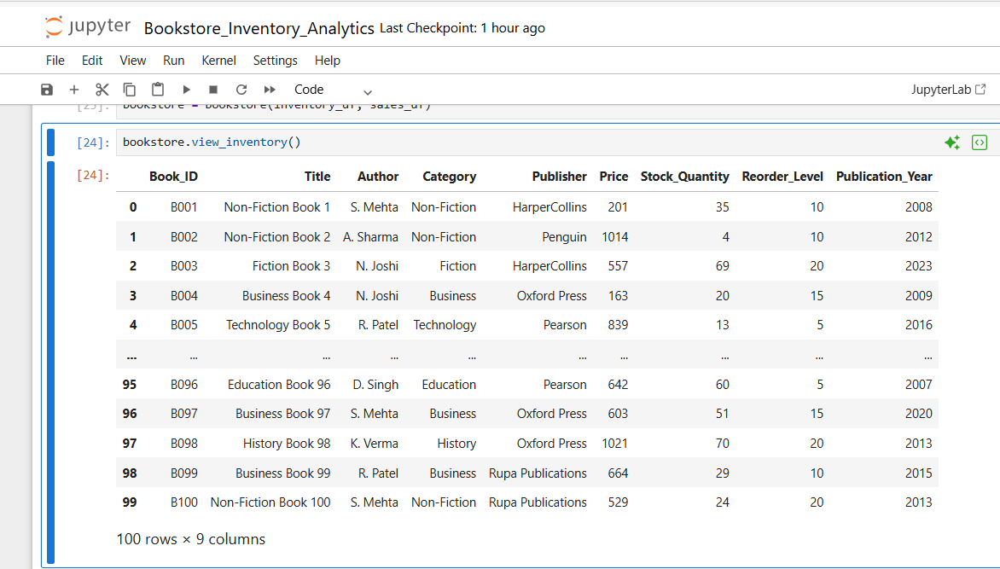
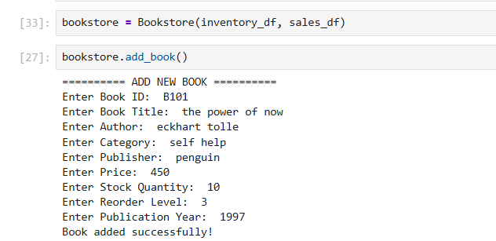
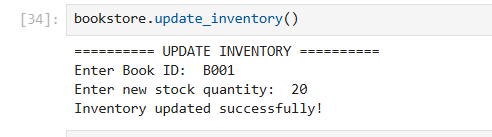
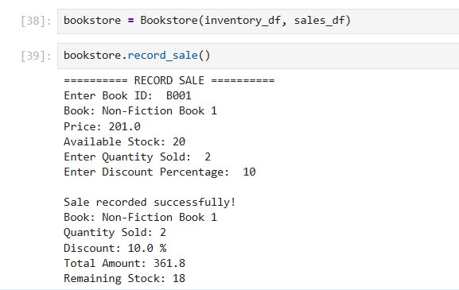
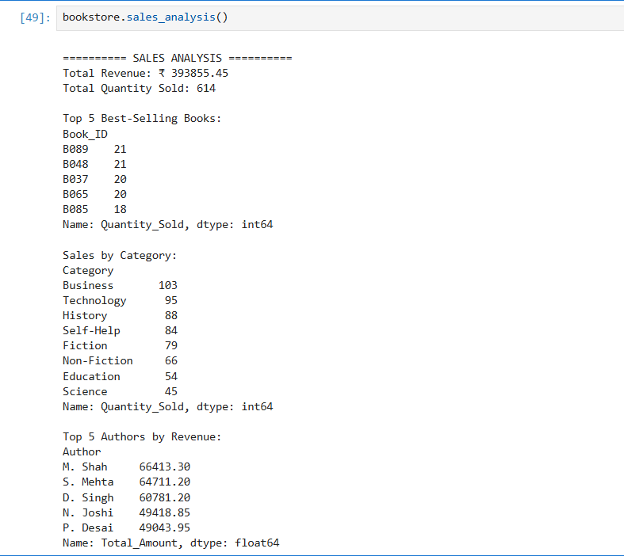
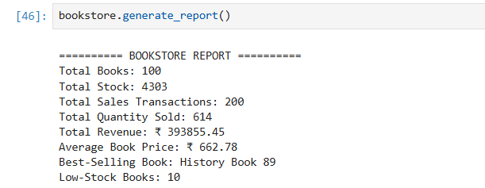
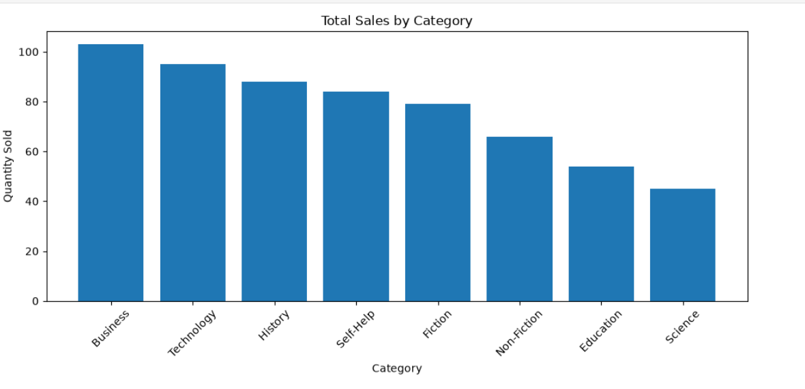
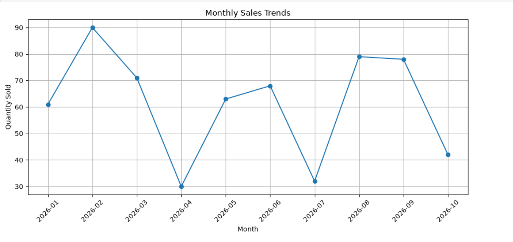
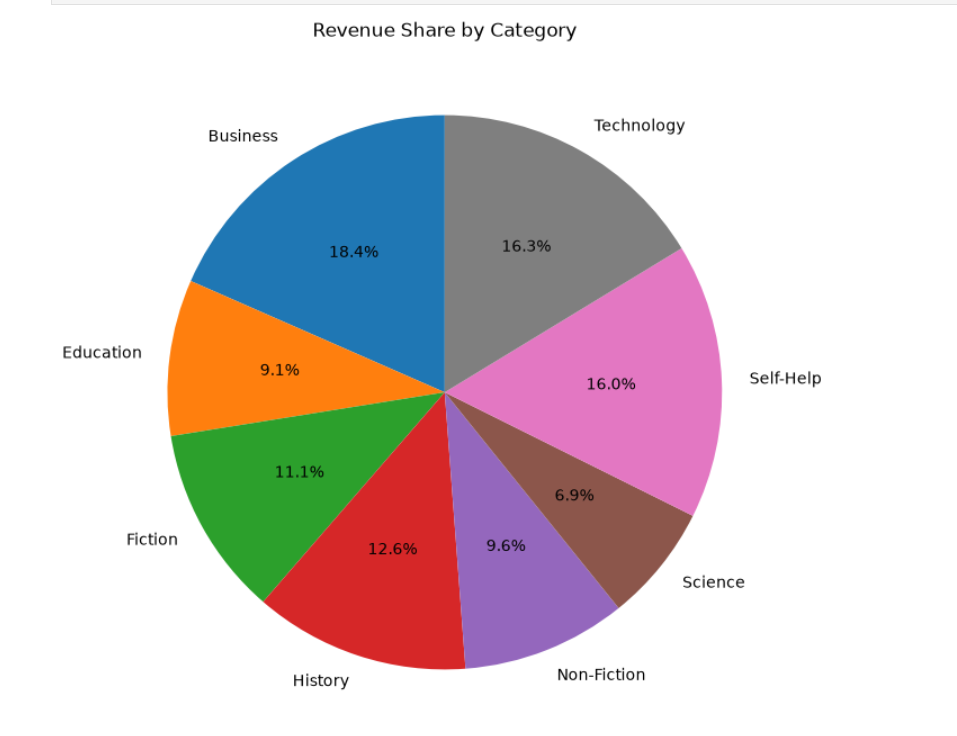
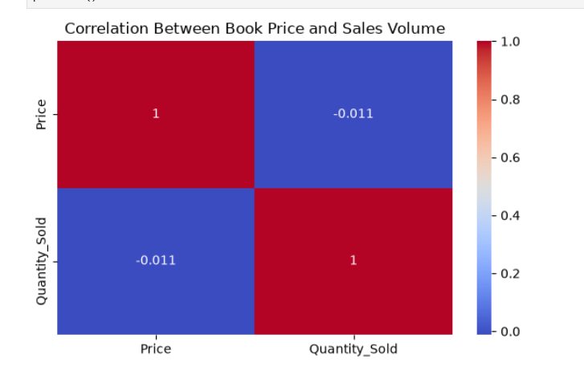

# 📚 Bookstore Inventory & Analytics System

## 1. Project Overview

The **Bookstore Inventory & Analytics System** is a Python-based project designed to manage bookstore inventory, record sales, analyze sales performance, and generate useful business insights.

The project uses Object-Oriented Programming (OOP) to organize bookstore operations and Pandas and NumPy for data processing and numerical analysis. Matplotlib and Seaborn are used to create visualizations that help understand sales trends, category-wise performance, revenue distribution, and correlations between numerical variables.

The project demonstrates a complete data analysis workflow, including dataset loading, data exploration, data-quality checks, inventory management, sales analysis, report generation, and data visualization.

## 2. Project Objectives

- Load and explore inventory and sales datasets.
- Understand dataset structure, dimensions, column names, and data types.
- Check for missing values and duplicate records.
- Perform data cleaning and preprocessing where required.
- Implement inventory management using OOP.
- Add books and update stock quantities.
- Record sales and calculate transaction amounts.
- Analyze revenue, quantity sold, and best-selling books.
- Perform numerical calculations using NumPy.
- Generate a bookstore performance report.
- Create four visualizations to present sales insights.

## 3. Technologies Used

| Technology | Purpose |
|---|---|
| Python | Core programming language |
| Object-Oriented Programming | Organizing bookstore operations |
| Pandas | Data loading, manipulation, and analysis |
| NumPy | Numerical calculations and statistics |
| Matplotlib | Data visualization |
| Seaborn | Correlation heatmap |
| Jupyter Notebook | Data analysis and visualization |
| Visual Studio Code | Writing and running Python code |
| CSV | Dataset storage |
| GitHub | Project hosting and documentation |

## 4. Project Workflow

The project follows these steps:

1. Load inventory and sales datasets.
2. Explore the datasets and inspect their structure.
3. Check missing values and duplicate records.
4. Clean and prepare data where necessary.
5. Implement inventory management functionality.
6. Record sales and analyze transactions.
7. Perform numerical and statistical calculations.
8. Generate a bookstore summary report.
9. Create four data visualizations.
10. Test the Python program and document the project.

## 5. Dataset Loading and Exploration

The project uses two CSV files: `inventory.csv` and `sales.csv`.

### 5.1 Loading the Datasets

Pandas is used to read the CSV files into DataFrames for analysis.

```python
import pandas as pd
import numpy as np
import matplotlib.pyplot as plt
import seaborn as sns

inventory_df = pd.read_csv("inventory.csv")
sales_df = pd.read_csv("sales.csv")
```

### 5.2 Viewing Dataset Records

The `head()` and `tail()` methods display the first and last records of a dataset.

```python
inventory_df.head()
inventory_df.tail()

sales_df.head()
sales_df.tail()
```

### 5.3 Checking Dataset Dimensions

The `shape` attribute identifies the number of rows and columns.

```python
print("Inventory Shape:", inventory_df.shape)
print("Sales Shape:", sales_df.shape)
```

### 5.4 Inspecting Column Names and Data Types

The `columns` attribute lists column names, while `info()` displays data types and non-null counts.

```python
print(inventory_df.columns)
inventory_df.info()

print(sales_df.columns)
sales_df.info()
```

### 5.5 Generating Descriptive Statistics

The `describe()` method provides statistical summaries of numerical columns, including the mean, minimum, maximum, and standard deviation.

```python
inventory_df.describe()
sales_df.describe()
```

These operations help understand the structure and characteristics of the datasets before performing analysis.

## 6. Data Cleaning and Preprocessing

Data cleaning helps improve data quality and makes analysis more reliable.

### 6.1 Checking Missing Values

The `isnull().sum()` method counts missing values in each column.

```python
print("Missing Values in Inventory:")
print(inventory_df.isnull().sum())

print("Missing Values in Sales:")
print(sales_df.isnull().sum())
```

This step helps identify incomplete records that may require attention.

### 6.2 Handling Missing Values

Missing values should be handled according to the dataset and the purpose of the analysis. Depending on the situation, rows may be removed or missing values may be filled using suitable values.

Example of removing rows containing missing values:

```python
inventory_df = inventory_df.dropna()
sales_df = sales_df.dropna()
```

*This example should only be considered part of the completed project if these operations were actually performed. If no missing values were found, report that result instead.*

### 6.3 Checking Duplicate Records

The `duplicated().sum()` method counts fully duplicated rows.

```python
print("Inventory Duplicates:", inventory_df.duplicated().sum())
print("Sales Duplicates:", sales_df.duplicated().sum())
```

### 6.4 Removing Duplicate Records

If duplicate rows are identified and confirmed to be unnecessary, they can be removed using `drop_duplicates()`.

```python
inventory_df = inventory_df.drop_duplicates()
sales_df = sales_df.drop_duplicates()
```

*Use this operation in your project description only if you actually removed duplicate records. Distinct sales transactions should not be deleted merely because some values match.*

## 7. Inventory Dataset Description

The `inventory.csv` dataset stores book information.

| Column | Description |
|---|---|
| `Book_ID` | Unique identifier for a book |
| `Title` | Title of the book |
| `Author` | Name of the author |
| `Category` | Category of the book |
| `Publisher` | Name of the publisher |
| `Price` | Price of the book |
| `Stock_Quantity` | Number of copies available |
| `Reorder_Level` | Stock threshold for identifying low inventory |
| `Publication_Year` | Year of publication |

## 8. Sales Dataset Description

The `sales.csv` dataset stores transaction information.

| Column | Description |
|---|---|
| `Sale_ID` | Unique identifier for a sale |
| `Date` | Date of the transaction |
| `Book_ID` | Identifier of the book sold |
| `Quantity_Sold` | Number of copies sold |
| `Unit_Price` | Price per copy |
| `Discount_Percent` | Discount percentage |
| `Total_Amount` | Total transaction amount |
| `Payment_Method` | Method of payment |
| `Customer_Type` | Type of customer |

## 9. Object-Oriented Programming

The project implements a `Bookstore` class that groups related inventory, sales, and reporting operations.

### Main Methods

- `__init__()` — Initializes the bookstore data.
- `view_inventory()` — Displays inventory information.
- `add_book()` — Adds a book to the inventory.
- `update_inventory()` — Updates the stock quantity.
- `record_sale()` — Records sales and calculates transaction details.
- `generate_report()` — Generates a summary report.
- `sales_analysis()` — Performs sales-related analysis.

Using a class helps organize the code, reuse methods, and maintain related functionality in one place.

## 10. Inventory Management Features

### 10.1 View Inventory

Displays book details such as title, author, category, price, and stock quantity.



### 10.2 Add a New Book

Allows new book information to be entered and added to the inventory.



### 10.3 Update Inventory

Updates the available stock quantity of an existing book.



## 11. Sales Management

### 11.1 Record a Sale

Records a book sale and calculates the transaction amount based on the applicable book price, quantity, and discount.



### 11.2 Sales Analysis

Analyzes sales information to understand revenue, quantity sold, transaction activity, and best-selling books.



Sales analysis can help identify popular books, evaluate category performance, and support inventory planning.

## 12. Numerical Analysis Using NumPy

NumPy supports numerical calculations and statistical analysis.

Depending on the operations performed in the notebook, numerical analysis may include:

- Average and mean calculations.
- Minimum and maximum values.
- Standard deviation.
- Numerical comparisons and array operations.

Example:

```python
prices = inventory_df["Price"].to_numpy()

print("Average Price:", np.mean(prices))
print("Minimum Price:", np.min(prices))
print("Maximum Price:", np.max(prices))
print("Standard Deviation:", np.std(prices))
```

This example demonstrates how NumPy can be used to analyze numerical data.

## 13. Bookstore Performance Report

The `generate_report()` method summarizes important inventory and sales metrics.

The report includes:

- Total number of books.
- Total stock quantity.
- Total sales transactions.
- Total quantity sold.
- Total revenue.
- Average book price.
- Best-selling book.
- Number of low-stock books.



## 14. Data Visualization

The project includes four visualizations to present important sales insights.

### 14.1 Bar Chart — Total Sales by Category

The bar chart compares sales quantities across book categories. It helps identify categories with higher or lower sales volume.



### 14.2 Line Chart — Monthly Sales Trends

The line chart presents monthly sales trends and helps observe changes in sales activity over time.



### 14.3 Pie Chart — Revenue Share by Category

The pie chart shows the contribution of different book categories to total revenue.



### 14.4 Heatmap — Correlation Between Numerical Variables

The heatmap visualizes correlations between numerical variables, such as book price, stock quantity, quantity sold, and total amount, depending on the columns used in the analysis.

Correlation can help reveal linear relationships between variables, but it does not prove causation.



## 15. Testing and Verification

The project can be tested by checking that:

- Both CSV files load successfully.
- Dataset dimensions and column information display correctly.
- Missing values and duplicate records can be inspected.
- Inventory information displays correctly.
- Book addition and stock updates work as expected.
- Sales calculations and reports execute successfully.
- All four visualizations are generated without errors.
- The Python program runs from the project folder.

## 16. Installation and Requirements

Install Python, then install the required libraries using:

```bash
pip install pandas numpy matplotlib seaborn jupyter
```

## 17. How to Run the Project

### Step 1: Download the Repository

Download the repository from GitHub and extract it, or clone it:

```bash
git clone YOUR_GITHUB_REPOSITORY_URL
```

Replace `YOUR_GITHUB_REPOSITORY_URL` with your repository URL.

### Step 2: Open the Project Folder

Open the project folder in Visual Studio Code or your preferred Python environment.

### Step 3: Check the Required Files

Ensure these files are present in the project folder:

- `bookstore.py`
- `Bookstore_Inventory_Analytics.ipynb`
- `inventory.csv`
- `sales.csv`

### Step 4: Run the Python Program

```bash
python bookstore.py
```

The program loads the datasets and displays the bookstore report.

### Step 5: Run the Jupyter Notebook

```bash
jupyter notebook
```

Open `Bookstore_Inventory_Analytics.ipynb` and execute the cells in order to explore the data analysis and visualizations.

## 18. Project Structure

```text
Bookstore_Inventory_Analytics/
│
├── bookstore.py
├── Bookstore_Inventory_Analytics.ipynb
├── inventory.csv
├── sales.csv
├── README.md
│
└── screenshots/
    ├── view_inventory.png
    ├── add_book.png
    ├── update_inventory.png
    ├── record_sale.png
    ├── sales_analysis.png
    ├── generate_report.png
    ├── bar_chart.png
    ├── line_chart.png
    ├── pie_chart.png
    └── heatmap.png
```

## 19. Applications

This project demonstrates how Python-based data analysis can support:

- Book inventory management.
- Sales transaction tracking.
- Category-wise sales and revenue analysis.
- Monthly sales monitoring.
- Business reporting and decision-making.

## 20. Learning Outcomes

Through this project, I gained practical experience in:

- Python programming and OOP.
- Creating and using classes and methods.
- Loading and exploring CSV datasets.
- Inspecting data types and dataset dimensions.
- Checking missing values and duplicate records.
- Understanding data cleaning and preprocessing.
- Performing calculations using Pandas and NumPy.
- Implementing inventory and sales operations.
- Generating reports from datasets.
- Creating visualizations using Matplotlib and Seaborn.
- Documenting and organizing a project on GitHub.

## 21. Future Enhancements

Possible future improvements include:

- Developing a graphical user interface.
- Integrating a database for persistent storage.
- Adding automatic low-stock notifications.
- Implementing sales forecasting.
- Exporting reports to PDF or Excel.
- Developing an interactive analytics dashboard.

## 22. Conclusion

The **Bookstore Inventory & Analytics System** demonstrates how Python programming, Object-Oriented Programming, data processing, numerical analysis, and data visualization can be combined in a practical application.

The project covers dataset exploration, data-quality checks, inventory management, sales recording, report generation, and visual analysis. These features help organize bookstore information and provide insights into sales performance and inventory levels.

## 23. Author

**Devansh Patel**

Academic Project — Bookstore Inventory & Analytics System

